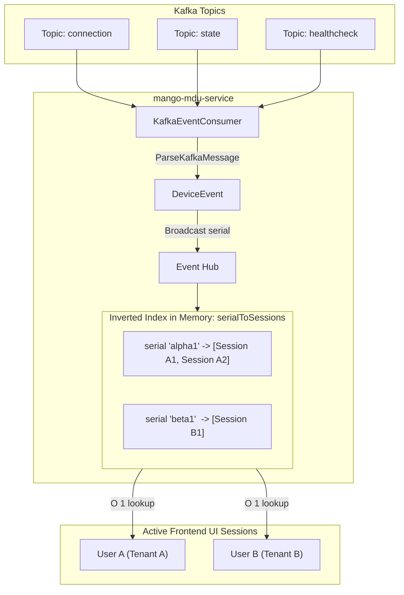

# Real-Time Device Event Streaming & Multi-Tenant Scoping Architecture

## 1. Executive Summary & Problem Statement

In the OpenWiFi architecture, the Operator UI originally considered establishing direct WebSocket connections (`wss://openwifi.wlan.local:16005/api/v1/ws`) to `owgw` (OpenWiFi Gateway) to receive live device connection states and telemetry.

However, this design introduces critical security and scalability bottlenecks:
1. **Lack of Tenant/Venue RBAC in OWGW**: `owgw` is a raw gateway service responsible for low-level device management (command RPCs, TLS connections with APs). It possesses no concept of multi-tenant policies, entities, or venue hierarchies managed by `owprov`.
2. **Data Leakage Risk**: Connecting UI clients directly to `owgw` would expose fleet-wide device telemetry across all organizations, violating multi-tenant boundaries.
3. **Attack Surface & Connection Overload**: 1,000+ concurrent browser connections hitting `owgw` creates significant connection overhead and exposes internal device command primitives to frontend clients.

### The Solution: MDU Backend Event Pipeline
Instead of UI clients connecting to `owgw`:
* **Zero changes in OWGW or OWPROV**.
* **Zero direct UI connections to OWGW**.
* **MDU Backend (`mango-mdu-service`)** acts as the secure, tenant-scoped streaming gateway:
  1. Consumes device events directly from Apache Kafka topics published by `owgw` (`connection`, `state`, `healthcheck`).
  2. Resolves each user's permitted device inventory from `owprov` (`GET /api/v1/inventory?serialOnly=true`) using the user's JWT.
  3. Maintains an **Inverted Index** (`serialToSessions`) in memory, delivering incoming device events to authorized UI clients in **$O(1)$** lookup time.

---

## 2. Kafka Event Ingestion from OWGW

Inspection of `ra-wlan-cloud-ucentralgw` confirms that `owgw` publishes all real-time device lifecycle and telemetry events to Kafka:

| Topic | OWGW Source | Payload Contents | MDU Event Normalization |
| :--- | :--- | :--- | :--- |
| **`connection`** | `AP_Process_connect.cpp`<br>`AP_Connection.cpp` | `serialNumber`, `firmware`, `connectionIp`, `timestamp`, or `disconnection: { serialNumber, timestamp }` | `DeviceEvent.Connected` (`true`/`false`), `ConnectionIP`, `Firmware`, `Timestamp` |
| **`state`** | `AP_Process_state.cpp` | `state.unit.memory` (`free`, `total`), `state.unit.load`, `radios`, `interfaces`, `uptime` | `DeviceEvent.MemoryPct`, `MemoryFree`, `MemoryTotal`, `Load`, `Timestamp` |
| **`healthcheck`**| `AP_Process_healthcheck.cpp` | `sanity` (0-100 score), `recorded` | `DeviceEvent.Sanity`, `Timestamp` |

### OWGW Message Envelope
OWGW wraps each event in a standard JSON envelope:
```json
{
  "system": { "id": 1, "host": "owgw.example.com" },
  "payload": {
    "serialNumber": "24f5a201b1a0",
    "connectionIp": "192.168.1.100",
    "firmware": "OpenWrt 21.02-SNAPSHOT",
    "timestamp": 1729850000
  }
}
```
The message key in Kafka is the device serial number (`string(msg.Key)`). MDU strips colons, dashes, and normalizes all serials to lowercase hex (`NormalizeSerial`).

---

## 3. User Authorization & Permission Resolution via OWPROV

### How MDU Knows Which Devices a User Can See
1. When a UI client connects to MDU with their Bearer JWT:
   ```http
   GET /api/v1/devices/events?token=<user_jwt>
   ```
2. MDU forwards the user's JWT to `owprov`:
   ```http
   GET /api/v1/inventory?serialOnly=true
   Authorization: Bearer <user_jwt>
   ```
3. `owprov` evaluates:
   * Caller role (`root`, `admin`, `operator`, etc.).
   * Associated entities (`AllowedEntities`) and venues (`AllowedVenues`) under active policy grants.
   * Returns a single lightweight JSON response containing only permitted device serials:
     ```json
     {
       "serialNumbers": [
         "24f5a201b1a0",
         "24f5a201b1a1"
       ]
     }
     ```
4. MDU caches the set of `AllowedSerials` on the client's `ClientSession`.

---

## 4. Multi-Tenant Inverted Index & $O(1)$ Event Routing

### The 1,000-Client Problem
If 1,000 active UI clients are connected and a device event arrives on Kafka:
* A naive loop over all 1,000 clients performing permission checks for every event results in $1000 \times \text{events/sec}$ evaluations, inducing high CPU utilization and latency.

### The Inverted Index Solution (`serialToSessions`)
MDU maintains an in-memory inverted index:
```go
type Hub struct {
    mu               sync.RWMutex
    sessions         map[string]*ClientSession
    serialToSessions map[string]map[string]*ClientSession // serialNumber -> map[sessionId]*ClientSession
}
```



### Mathematical Guarantees:
1. **Zero Data Leakage**:
   * Device `alpha1` belongs to Tenant A.
   * Only sessions belonging to Tenant A are present in `serialToSessions["alpha1"]`.
   * When an update for `alpha1` arrives, lookup `serialToSessions["alpha1"]` directly retrieves Tenant A sessions. Tenant B sessions never receive the event.
2. **Privilege Escalation Prevention**:
   * If a client explicitly requests to subscribe to `alpha1` via `POST /api/v1/devices/events/subscriptions`, MDU performs strict set intersection:
     $$\text{Granted} = \text{RequestedSerials} \cap \text{session.AllowedSerials}$$
   * Unauthorized serials are stripped before indexing.
3. **Low Memory Overhead**:
   * 1,000 connected clients viewing a page of 25 devices = 25,000 pointer entries.
   * Memory footprint: **$< 2 \text{ MB}$** of RAM.
4. **Slow Consumer Protection**:
   * Uses buffered channels (`make(chan []byte, 256)`) with non-blocking `select`:
     ```go
     select {
     case session.Send <- payload:
     default:
         // Drop event to prevent head-of-line blocking on sluggish network links
     }
     ```

---

## 5. Protocols & Streaming Endpoints

### 5.1 The Browser `401 Unauthorized` Challenge & OpenWiFi Architecture

When connecting via Server-Sent Events (SSE) with `new EventSource(url)`:
1. **W3C Browser Limitation**: The native browser `EventSource` API standard **does not permit setting custom HTTP headers** (such as `Authorization: Bearer <token>`).
2. **Security & Proxy Bottleneck**: Passing JWTs as query parameters (`?token=...`) leaks access tokens into server access logs, reverse proxy logs, browser histories, and `Referer` headers. Furthermore, strict reverse proxies and API gateways expecting header-based authentication reject these requests with `401 Unauthorized`.

### 5.2 OpenWiFi Production WebSocket Pattern (`/api/v1/ws` and `/ws`)

Inspection of OpenWiFi production microservices (`ra-wlan-cloud-owprov` and `ra-wlan-cloud-owprov-ui`) demonstrates how OpenWiFi solves this problem:

1. **Unauthenticated HTTP Upgrade Handshake**:
   - In `owprov` (`RESTAPI_WebSocketServer.h`), the WebSocket upgrade handler sets `AlwaysAuthorize = false`.
   - In `mango-mdu-service`, routes `/api/v1/ws` and `/ws` are mounted directly before the JWT authentication middleware (`deps.AuthHandler`).
   - The browser initiates standard HTTP `Upgrade: websocket` without needing custom headers.
2. **In-Band First-Frame Token Authentication**:
   - Immediately upon socket open (`ws.onopen`), the client transmits an authentication frame:
     ```
     ws.send("token:" + token)
     ```
   - The server enforces a 10-second read deadline for this initial frame.
   - The server validates the token with `owsec` (`tokenValidator.ValidateToken`). If invalid or expired, the socket is immediately closed with code 4401 (`Unauthorized`).
3. **RBAC Scope Resolution & Welcome Frame**:
   - Upon successful token validation, the server queries `owprov` (`hub.AuthorizeUser`) to fetch the caller's permitted device inventory (`GET /api/v1/inventory?serialOnly=true`).
   - The server sends the standard OpenWiFi welcome message:
     ```json
     {
       "success": "Welcome! Bienvenue! Bienvenidos!",
       "sessionId": "4a7c1b8e9..."
     }
     ```
4. **Dynamic Viewport Subscriptions Over WebSocket**:
   - The frontend transmits JSON frames indicating the visible pagination viewport:
     ```json
     {
       "serials": ["24f5a201b1a0", "24f5a201b1a1"]
     }
     ```
   - The server validates that all requested serials exist in the user's permitted inventory, and updates the in-memory inverted index (`serialToSessions`).
5. **Real-Time Telemetry Push & Keepalives**:
   - Outbound goroutine monitors `session.Send` channel.
   - Pushes normalized JSON device events whenever Kafka events arrive.
   - Transmits periodic keepalive frames (`:keepalive <timestamp>`) every 30 seconds to prevent NAT/proxy timeouts.

```mermaid
sequenceDiagram
    autonumber
    actor User as Operator Browser
    participant MDU as MDU Backend (/api/v1/ws)
    participant OWSEC as OWSEC Auth
    participant OWPROV as OWPROV Inventory
    participant Kafka as OWGW Kafka Topics

    User->>MDU: 1. GET /api/v1/ws (HTTP 101 Switching Protocols)
    Note over User,MDU: Handshake succeeds without custom HTTP headers
    User->>MDU: 2. First Frame: "token:<JWT>"
    MDU->>OWSEC: 3. Validate Token
    OWSEC-->>MDU: Token Valid (User ID, Roles)
    MDU->>OWPROV: 4. GET /api/v1/inventory?serialOnly=true
    OWPROV-->>MDU: Allowed Serials: ["24f5a201b1a0", "24f5a201b1a1"]
    MDU-->>User: 5. Frame: {"success":"Welcome! Bienvenue! Bienvenidos!","sessionId":"..."}
    User->>MDU: 6. Frame: {"serials":["24f5a201b1a0"]} (Page 1 Viewport)
    MDU->>MDU: Update Inverted Index (serialToSessions)
    Kafka->>MDU: 7. Device Event ("24f5a201b1a0" State Update)
    MDU->>MDU: O(1) Lookup: serialToSessions["24f5a201b1a0"]
    MDU-->>User: 8. Frame: {"type":"state","serialNumber":"24f5a201b1a0",...}
    Note over User: React Query cache updated; UI table reflects live state
```

---

## 6. API Endpoints

### 1. `GET /api/v1/ws` and `GET /ws`
* **Protocol**: WebSocket (`wss://`).
* **Authentication**: In-band first-frame: `token:<token>`.
* **Client to Server Commands**:
  * Viewport update: `{"serials": ["24f5a201b1a0", "24f5a201b1a1"]}`
* **Server to Client Messages**:
  * Welcome: `{"success":"Welcome! Bienvenue! Bienvenidos!","sessionId":"..."}`
  * Device update: `{"type":"connection","serialNumber":"24f5a201b1a0","connected":true,...}`
  * Keepalive: `:keepalive 1729850015`

### 2. `GET /api/v1/devices/events` (Fallback SSE)
* **Protocol**: Server-Sent Events (SSE, `text/event-stream`).
* **Authentication**: `Authorization: Bearer <token>` or `?token=<token>`.
* **Query Parameters**:
  * `serials` (optional): Comma-separated list of viewport serial numbers.

### 3. `POST /api/v1/devices/events/subscriptions`
* **Purpose**: Updates viewport subscriptions for HTTP/SSE clients.
* **Request**:
  ```json
  {
    "sessionId": "3c1a8e9...",
    "serials": ["24f5a201b1a0", "24f5a201b1a1"]
  }
  ```

---

## 7. Implementation Summary & Component Map

| Component | File Path | Responsibility |
| :--- | :--- | :--- |
| **WebSocket Handler** | [`internal/http/handlers/device_events_handler.go`](file:///home/iotina/routerarchitects_repos/mango-mdu-service/internal/http/handlers/device_events_handler.go) | Serves `/api/v1/ws` and `/ws` with OpenWiFi first-frame auth, welcome handshake, and dynamic viewport subscription. |
| **Kafka Event Parser** | [`internal/events/events.go`](file:///home/iotina/routerarchitects_repos/mango-mdu-service/internal/events/events.go) | Unwraps OWGW Kafka envelopes, extracts and normalizes connection, state, and healthcheck data. |
| **Multi-Tenant Hub** | [`internal/events/hub.go`](file:///home/iotina/routerarchitects_repos/mango-mdu-service/internal/events/hub.go) | Manages client sessions, resolves OWPROV permissions, and maintains the $O(1)$ inverted index. |
| **Kafka Consumer** | [`internal/events/consumer.go`](file:///home/iotina/routerarchitects_repos/mango-mdu-service/internal/events/consumer.go) | Background consumer subscribing to `connection`, `state`, and `healthcheck` topics. |
| **OWPROV Gateway** | [`internal/gateway/owprov/client.go`](file:///home/iotina/routerarchitects_repos/mango-mdu-service/internal/gateway/owprov/client.go) | Implements `GetInventorySerials` via `GET /api/v1/inventory?serialOnly=true`. |
| **Frontend WebSocket Hook** | [`mango-operator-ui/src/api/devices.ts`](file:///home/iotina/routerarchitects_repos/mango-operator-ui/src/api/devices.ts) | `useDeviceEventsStream`: WebSocket connection with `token:<token>` auth and reactive cache updates. |
| **App Lifecycle** | [`internal/app/app.go`](file:///home/iotina/routerarchitects_repos/mango-mdu-service/internal/app/app.go) | Wires Hub, Consumer, Handler, and TokenValidator with graceful startup and shutdown. |

---

## 8. Verification & Test Suite

All tests execute and pass:
* **`internal/events` (11 tests)**:
  * `TestParseConnectionEvent_Connect`: Verifies connect payload parsing and normalization.
  * `TestParseConnectionEvent_Disconnect`: Verifies disconnection event detection.
  * `TestParseStateEvent_Success`: Verifies CPU load and memory percentage calculation.
  * `TestParseHealthcheckEvent_Success`: Verifies sanity score extraction.
  * `TestHub_MultiTenantIsolation`: Rigorously verifies cross-tenant isolation, privilege escalation rejection, and unowned device dropping.
  * `TestKafkaEventConsumer_ProcessMessage_BroadcastsToHub`: Verifies end-to-end Kafka-to-Hub dispatch.
* **`internal/http/handlers` (14 tests)**:
  * Verifies missing auth rejection, downstream error translation, invalid body rejection, WebSocket handshake, and viewport updates.
* **`mango-operator-ui` (57 tests)**:
  * Full frontend suite passes with zero regressions, including `useDeviceEventsStream` OpenWiFi production WebSocket protocol test.


